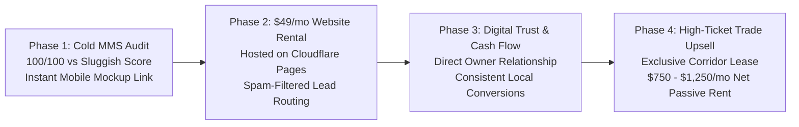

# AGENTS.md — WNC Website Rental Monorepo & Client Operations

> Production Architecture & AI Engineering Mandates for `barebones3d/website-rental-mono-repo`  
> Parent Entity: **Barebones 3D, L.L.C. d/b/a Ridgeline Trade Network**  
> Operational Lead: **Brandon** (Hendersonville, NC)

---

## 1. Executive Summary & Business Model

This repository houses the **Client Website Rental Portfolio** for Western North Carolina trade contractors. It serves as the primary frontline acquisition and retention vehicle for the **WNC Trade Network** (19 regional trade properties, including `wnctreeremoval.com`, `wncexcavating.com`, `wncroofingrepair.com`, etc.).

### The $49/Month Website Rental Engine
- **The Core Problem:** Mountain trade contractors in WNC are master craftsmen but digital ghosts. They either have no website, a non-responsive Facebook page, or an ancient DIY site scoring 15–35/100 on Google PageSpeed with broken mobile forms.
- **The Offer:** A bespoke, blisteringly fast (< 1s load, 100/100 PageSpeed), mobile-first website hosted on Cloudflare's global edge network with custom domain setup, continuous maintenance, and zero hosting headaches for a flat **$49/month** (or $50/month).
- **The Trojan Horse (The Upsell):** Once a contractor is actively paying monthly rent and receiving direct client calls, we introduce the **WNC Trade Network Exclusive Corridor Lease** (routing all unbranded Google traffic from `wnc[trade].com` directly to their dispatch phone for $750–$1,250/mo).

---

## 2. Ideal Client Demographic Profile

To maximize conversion rate and long-term retention, prospect selection must adhere to this demographic profile:

1. **Trade Vertical (High Average Ticket Size):**
   - Minimum average invoice: **$2,500 – $25,000+**
   - Priority Trades: Excavating & Land Clearing, Tree Removal & Crane Work, Septic Repair & Pumping, Retaining Walls & Hardscaping, Driveway Paving & Grading, Crawlspace Encapsulation & Waterproofing, Log Home Restoration, Well Pump & Water Systems, Deck Building, Roofing Repair.
   - *Rationale:* A single client job covers 3 to 10 years of website hosting rent.
2. **Business Scale:**
   - 1 to 8 man field crews; owner-operator or working foremen.
   - Owner answers their own phone or carries the dispatch mobile.
3. **Geographic Coverage:**
   - Western North Carolina across the 8 defined economic corridors (Highlands-Cashiers, Southern Plateau, Metro Asheville, Central West, High Country Mining, Far West, East Foothills, Yadkin Valley).
4. **Digital Vulnerability:**
   - Mobile PageSpeed score < 45/100, sluggish time-to-first-byte (> 1.5s), lack of SSL, unreadable text on phones, or no website at all.
5. **Direct Channel Access:**
   - Verified direct cell phone number for the business owner (allowing direct SMS/MMS communication without gatekeepers).

---

## 3. Strict Non-Compete SEO Architecture Guardrail

> [!CRITICAL]
> **Client rental sites MUST NOT compete for the broad generic ranking corridors targeted by the 19 WNC Trade Network sites.**

| Strategy Dimension | WNC Trade Network (`wnc[trade].com`) | Client Rental Sites (`sites/<client>/`) |
| :--- | :--- | :--- |
| **Search Intent** | Broad generic transactional & emergency queries (e.g. *"emergency tree removal asheville nc"*, *"land clearing western north carolina"*) | Brand entity queries, hyper-local NAP citations, and direct referral verification (e.g. *"Turning Leaf Tree Service"*, *"Mark Pace Excavating Hendersonville"*) |
| **Domain Scope** | 23-county regional coverage mapped to 8 macro-corridors | Single business entity with specific operating address and service radius polygon |
| **Schema.org Type** | Regional Service Directories & Emergency Corridors (`Service`, `FAQPage`, `BreadcrumbList`) | Strict `LocalBusiness` schema with exact GeoCoordinates, verified legal name, license badges, and verified phone |
| **Content Strategy** | Educational mountain geology, soil mechanics, corridor comparison matrices | Direct trust signals: owner bio, equipment photos, customer reviews, direct phone click-to-call, license proof |
| **Interlinking Policy** | Zero cross-linking between network domains | Zero links back to WNC Trade Network until the client executes an official corridor lease agreement |

---

## 4. Architectural & Engineering Standards

### 1. Site Isolation Mandate
- Every client website resides strictly inside its own subdirectory within `/sites/<client-slug>/` (e.g., `/sites/pace-excavating/`, `/sites/turning-leaf-tree/`).
- **Zero Cross-Site Coupling:** Sites must NEVER share scripts, CSS, or assets across sibling folders in `/sites/`. Each site must be completely standalone so Cloudflare Pages can serve it with zero build friction.
- Root repository features a master client showcase portal (`index.html`) allowing prospective clients to preview their site alongside live performance audits.

### 2. 100/100 PageSpeed Mandate
- Mobile and Desktop scores must achieve 100/100 on Google PageSpeed Insights.
- **Inlined Critical CSS:** All styles must be fully inlined in `<style id="inlined-styles">` in the `<head>` of `index.html`.
- **System Font Stack:** Zero external font network calls (no Google Fonts, no Typekit). Use high-grade system typography:  
  `font-family: -apple-system, BlinkMacSystemFont, "Segoe UI", Roboto, "Helvetica Neue", Arial, sans-serif;`
- **Zero Render-Blocking Bloat:** No React, Next.js, jQuery, or third-party tracking scripts. Clean vanilla JavaScript for interactive mobile drawers and modals.
- **Inline SVG Graphics:** Technical diagrams, certification badges, and structural icons must use clean, compressed inline SVGs.

### 3. Programmatic & Script-Driven Operations
- File generation, schema generation, PageSpeed audits, and Cloudflare deployments must be executed via standalone scripts in `/scripts/`.
- No hand-editing repetitive HTML or JSON files.

### 4. Git & Cloudflare Pages Integration
- Always stage, commit, and push validated work to GitHub `origin/main` using conventional commit prefixes (`feat:`, `fix:`, `docs:`, `perf:`).
- Deployments to Cloudflare Pages are orchestrated via `scripts/deploy_cloudflare_pages.py` utilizing the Cloudflare API tokens from `.env`.

---

## 5. Cold Outreach MMS / SMS Pitch Framework

For each audited business, Brandon receives a ready-to-send SMS payload consisting of:
1. **The Hook:** Acknowledge their craft and local reputation.
2. **The Contrast:** Hard, undeniable Google PageSpeed numbers (Their current score e.g. 28/100 vs Our rebuilt mockup at 100/100).
3. **The Proof:** A live preview link (`https://preview.ridgelinetrade.com/sites/<client-slug>/`) with a high-resolution mobile screenshot.
4. **The No-Brainer Offer:** $49/mo flat rate, zero setup fee, no contracts, we handle domain pointing, updates, and fast hosting.
