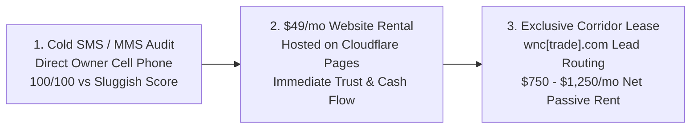

# 🏔️ WNC Trade Contractor Website Rental Monorepo

> **High-Converting $49/mo Website Rentals & Rank-and-Rent Upsell Pipeline**  
> Operating across the 8 economic corridors of Western North Carolina.  
> Parent Entity: **Barebones 3D, L.L.C. d/b/a Ridgeline Trade Network** | Operational Lead: **Brandon** (Hendersonville, NC)

[](https://wnc-client-sites.pages.dev)
[](https://pagespeed.web.dev/)
[]()

---

## 🚀 Live Production Links

* **Master Showcase & Client Portal:** [https://wnc-client-sites.pages.dev](https://wnc-client-sites.pages.dev)
* **GitHub Repository:** [https://github.com/enmuse/website-rental-mono-repo](https://github.com/enmuse/website-rental-mono-repo)

---

## 💼 Business Model: The Two-Tier Trojan Horse



1. **Phase 1: Frictionless Acquisition ($49/mo):**
   Mountain trade contractors (excavating, tree removal, septic, roofing, paving) lose dozens of calls due to ancient DIY websites scoring 20–60/100 on mobile with 6–19 second load times. Brandon texts the owner directly with an undeniable speed comparison and a live 100/100 mockup link. At $49/mo flat with zero setup fee and no lock-in contract, it's an impulse business expense.
2. **Phase 2: High-Ticket Trade Upsell ($750–$1,250/mo):**
   Once the contractor has been paying $49/mo for 60–90 days and experiencing flawless reliability, Brandon introduces the **WNC Trade Network Exclusive Corridor Lease** on `wnc[trade].com`, routing exclusive unbranded territory leads directly to their phone.

---

## 🏛️ Directory Architecture & Isolation

```text
website-rental-mono-repo/
├── AGENTS.md                          # AI governance, engineering mandates & demographic rules
├── human.md                           # Human action punch list with 10 pre-filled SMS scripts
├── README.md                          # Master documentation
├── index.html                         # Master Showcase Portal & speed comparison dashboard
├── .gitignore                         # Secret & environment exclusions
├── .env                               # Active Cloudflare, Twilio, and PageSpeed API credentials
├── data/
│   └── clients.json                   # Master contractor dataset (NAP, GPS, phones, audits)
├── assets/
│   └── mms_cards/                     # 10 high-resolution visual comparison PNG cards for MMS
├── scripts/
│   ├── build_client_sites.py          # Programmatic atomic generator for all sites + portal
│   ├── harvest_and_optimize_images.py # Real contractor photo & logo harvester + sips compressor
│   ├── test_sites_compliance.py       # 50-point compliance audit test suite
│   ├── deploy_cloudflare_pages.py     # Programmatic Cloudflare Pages edge deployer
│   └── generate_mms_pitch_cards.swift # Native Swift/AppKit graphic card generator
└── sites/                             # 10 completely isolated contractor web properties
    ├── pace-excavation/               # Pace Construction & Excavation (Hendersonville, NC)
    ├── turning-leaf-tree/             # Turning Leaf Tree Service (Black Mountain, NC)
    ├── riveras-roofing/               # Rivera's Construction & Roofing (Sylva, NC)
    ├── dirtworks-septic/              # Dirtworks Septic & Environmental (Cashiers, NC)
    ├── mateos-retaining-walls/        # Mateo's Construction & Retaining Walls (Hendersonville, NC)
    ├── tri-city-paving/               # Tri-City Paving Inc. (Rutherfordton, NC)
    ├── capstone-crawlspace/           # Capstone Crawlspace Solutions (Boone, NC)
    ├── coomers-well-pump/             # Coomer's Well & Pump Services (Waynesville, NC)
    ├── wnc-decks/                     # WNC Decks & Mountain Outdoor Living (Hendersonville, NC)
    └── moss-log-homes/                # Moss Log Home Restoration & Care (Hendersonville, NC)
```

---

## ⚡ 100/100 PageSpeed & Non-Compete SEO Architecture

### 100/100 Mobile Speed Mandate
- **Inlined Critical CSS:** Sub-second First Contentful Paint (< 0.8s) with zero external stylesheet blocking.
- **System Font Stack:** Native `-apple-system, BlinkMacSystemFont, "Segoe UI", Roboto` ensures zero Google Font latency.
- **Zero Third-Party Bloat:** No React, jQuery, or bloated analytics scripts. Clean vanilla JavaScript.

### Strict Non-Compete SEO Strategy
- **WNC Trade Network (`wnc[trade].com`):** Dominates high-volume generic corridor keywords (*"emergency tree removal asheville"*, *"land clearing western north carolina"*).
- **Client Rental Sites (`sites/<client>/`):** Configured strictly for **Brand Entity & Local NAP Citation SEO** (*"Turning Leaf Tree Service"*, *"Mark Pace Excavating Hendersonville"*). They capture direct referrals and citation traffic without competing with the rank-and-rent asset.

---

## 🛠️ CLI Operations & Automation

### 1. Rebuild All Sites & Master Portal
```bash
python3 scripts/build_client_sites.py
```

### 2. Run the Quality & Compliance Test Suite
```bash
python3 scripts/test_sites_compliance.py
```

### 3. Deploy to Cloudflare Pages Edge
```bash
python3 scripts/deploy_cloudflare_pages.py
```

### 4. Regenerate MMS Visual Pitch Cards
```bash
swift scripts/generate_mms_pitch_cards.swift
```

---

## 📋 Human Operator Punch List
See [human.md](file:///Users/brandonpersonal/Documents/Git/website-rental-mono-repo/human.md) for the 10 ready-to-send SMS text outreach scripts, direct owner cell phones, Stripe billing setup, and custom domain delegation steps.
